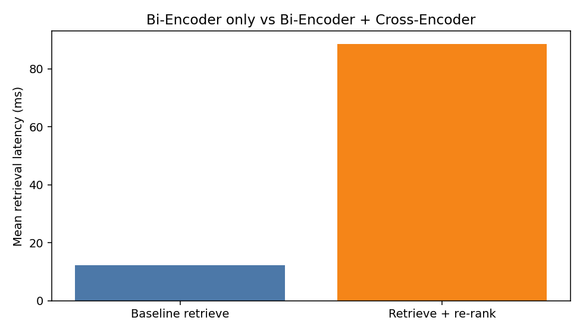

I indexed one document, the *Magic: The Gathering Comprehensive Rules* (19 September 2025, 304 pages). The book is a good stress set because the same word can mean two different things (`counter`), later rules override earlier ones, and many clauses are written as `can't` / `doesn't`.

Both pipelines use the same chunks, the same Bi-Encoder index, the same prompt, and the same generator (`Qwen/Qwen2.5-1.5B-Instruct` on a Kaggle T4). The only difference is which three of the Top-10 chunks are sent to the LLM.

| Piece | Model |
|---|---|
| Bi-Encoder | `sentence-transformers/all-MiniLM-L6-v2` |
| Vector search | FAISS `IndexFlatIP` on L2-normalised vectors (cosine) |
| Cross-Encoder | `cross-encoder/ms-marco-MiniLM-L-6-v2` |
| LLM | `Qwen/Qwen2.5-1.5B-Instruct`, fp16 |
| Retrieve / context | Top 10 $\rightarrow$ Top 3 |

# 1. Architecture comparison

A **Bi-Encoder** runs the query and each chunk through the same transformer **separately**. Each side becomes one vector. Scoring is just cosine similarity. That is why the whole corpus can be embedded once, stored in FAISS, and a new query is one forward pass plus cheap inner products.

A **Cross-Encoder** concatenates `(query, chunk)` and runs **joint** self-attention over both sequences. Tokens in the question can attend directly to tokens in the passage, so the model can tell "counter a *spell*" from "put a *counter* on a permanent". The cost is one full transformer pass **per pair**. There is no offline index of Cross-Encoder scores.

I therefore use the Bi-Encoder as a candidate generator (Top 10) and the Cross-Encoder only as a re-ranker of those ten pairs. Pipeline 1 takes ranks 1-3 as-is. Pipeline 2 sorts the same ten by Cross-Encoder score and then takes the new Top 3.

# 2. Qualitative and rank-shift analysis

Chunks are packed by sibling subrule (e.g. `305.2` + `305.2a` + `305.2b`), not by a sliding character window. Gold rank is the first chunk whose **heading** is the target rule, so a "see rule 701.6" citation does not count as a hit.

**Table 1.** Gold-clause ranks. Positive shift means the Cross-Encoder promoted the clause.

| Query | Failure type | Gold heading | Baseline rank | Re-rank rank | Shift | In baseline Top 3 | In re-rank Top 3 |
|---|---|---|---:|---:|---:|---|---|
| Q1 | Keyword trap | 701.6 | 3 | **1** | +2 | yes | yes |
| Q2 | Exception | 305.3 | 1 | 1 | 0 | yes | yes |
| Q3 | Negation | 605.3b (inside 605.3) | 1* | 1* | 0 | yes* | yes* |
| Q4 | Buried / document-specific | 111.6 | 1 | **5** | -4 | yes | **no** |

\*Letter subrules `605.3a` / `605.3b` sit in the parent chunk `605.3`, so the heading matcher left those cells blank. Inspection of the Top-10 trace shows `605.3` (which contains 605.3b) at rank 1 in both pipelines.

## Q1 - keyword trap (this is the clean win)

Query: *When you counter a spell, do you put a counter on that spell, and where does the spell card go?*

The Bi-Encoder ranked **122.6** first (`counters` as markers placed on an object). **122.1** was still in the Top 10 (rank 4). The actual keyword action **701.6 / 701.6a** ("cancel it, removing it from the stack... put into its owner's graveyard") sat at **rank 3**.

After Cross-Encoder scoring:

- **701.6: rank 3 $\rightarrow$ rank 1** (CE score 4.25)
- **122.6: rank 1 $\rightarrow$ rank 2**
- **122.1: rank 4 $\rightarrow$ rank 6** (CE score dropped to -0.22)

So the distractor was pushed down and the verb sense was promoted, which is exactly the lexical-overlap failure the brief asked for.

Answer 1 (baseline Top 3) still used 701.6a even though it was last of the three, and stated the graveyard correctly. Answer 2 had 701.6 at rank 1, but the 1.5B model added an extra clause that the card "remains in your hand". That is a **generator error**, not a retrieval miss: the retrieved text says graveyard.

## Q2 - exception

Query: *Can an effect instruct me to play a land during my opponent's turn?*

Rule **305.3** ("A player can't play a land, for any reason, if it isn't their turn. Ignore any part of an effect that instructs a player to do so.") was already **rank 1** for the Bi-Encoder. The Cross-Encoder agreed (CE 5.66) and left it at rank 1. Both answers cited 305.3 and said no. This query did **not** need re-ranking; the dense retriever already found the exception.

## Q3 - negation

Query: *Can an opponent respond to, target, or counter an activated mana ability?*

Chunk **605.3** (including 605.3b: the ability "doesn't go on the stack, so it can't be targeted, countered, or otherwise responded to") was rank 1 in both pipelines. Both answers said **no**, which is correct. They cited **605.3a** (when you *may* activate) rather than 605.3b. The Bi-Encoder did not flip polarity here; the "can't" clause was in the same packed chunk as the "may" clause, so cosine similarity never had to choose between them.

## Q4 - re-ranking made the context worse

Query: *If a creature token is destroyed, is that token a card waiting in the graveyard?*

Baseline Top 3 started with **111.6** ("A token isn't a card"). Answer 1 was mostly right: not a card, it ceases to exist.

The Cross-Encoder **demoted** 111.6 from rank 1 to rank 5 and promoted **704.5** (state-based actions, a long mixed chunk) from rank 6 to rank 1. Gold 111.6 left the Top 3. Answer 2 then claimed the token is **returned to hand**, which is wrong.

I am reporting this as a real failure of the re-ranker, not as a success. A Cross-Encoder can over-weight a related heading (state-based actions) and drop the short definition that actually answers the question.

# 3. Latency profiling

Times are wall-clock milliseconds on a Kaggle T4. Retrieval and generation were timed separately. The first baseline retrieve (21.42 ms) includes encoder warmup; later baseline retrieves sit near 9 ms.

**Table 2.** Per-query latency (ms).

| Query | P1 retrieve | P2 retrieve | P2 re-rank | P2 retrieval total | P1 generate | P2 generate |
|---|---:|---:|---:|---:|---:|---:|
| Q1 | 21.42 | 7.64 | 103.38 | 111.02 | 3151 | 3071 |
| Q2 | 9.36 | 6.88 | 85.46 | 92.34 | 2626 | 2591 |
| Q3 | 9.62 | 6.86 | 48.31 | 55.17 | 4307 | 3663 |
| Q4 | 8.94 | 7.09 | 88.91 | 96.01 | 3825 | 2989 |
| **Mean** | **12.34** | **7.12** | **81.52** | **88.64** | **3477** | **3079** |

Re-ranking ten MiniLM pairs costs about **80 ms** on GPU, roughly **9$\times$** the steady Bi-Encoder retrieve. LLM generation is **2.6-4.3 s**, two orders of magnitude larger, so the extra retrieve cost is small in end-to-end RAG. The comparison that matters for the assignment is still retrieve vs retrieve+re-rank, because generation is identical in structure.

# 4. Why not Cross-Encode the whole collection?

Let $N$ be the number of chunks (here on the order of one to two thousand numbered rule groups). A Cross-Encoder score is a full transformer forward on one `(query, chunk)` pair.

- Cost per query for brute-force Cross-Encoder: $\Theta(N)$ expensive forwards, with no reuse from previous queries.
- Cost per query for the Bi-Encoder: **one** query embed + $N$ inner products (or an ANN lookup). Chunk vectors are computed **once** at index time.

MiniLM Cross-Encoder on this GPU is already ~8 ms per pair if you scale the 10-pair / 80 ms figure. Over $N \approx 1500$ chunks that would be on the order of **12 seconds per query** before the LLM even runs, and it grows linearly with the book. FAISS inner product over the same $N$ is milliseconds.

The two-stage design is the compromise: Bi-Encoder recall gets the right neighbourhood (Top 10 still contained 701.6 on Q1 and 305.3 on Q2). Cross-Encoder precision is spent only where token-level interaction is worth it. Q4 shows that this second stage is not guaranteed to help, which is another reason not to trust it as the only scorer over the full set.

# Notes for the notebook

Code is in `rag_baseline_vs_rerank.ipynb`. Traces used in this report are `outputs/rank_shifts.csv`, `outputs/latency.csv`, and `outputs/run_trace.json`.
